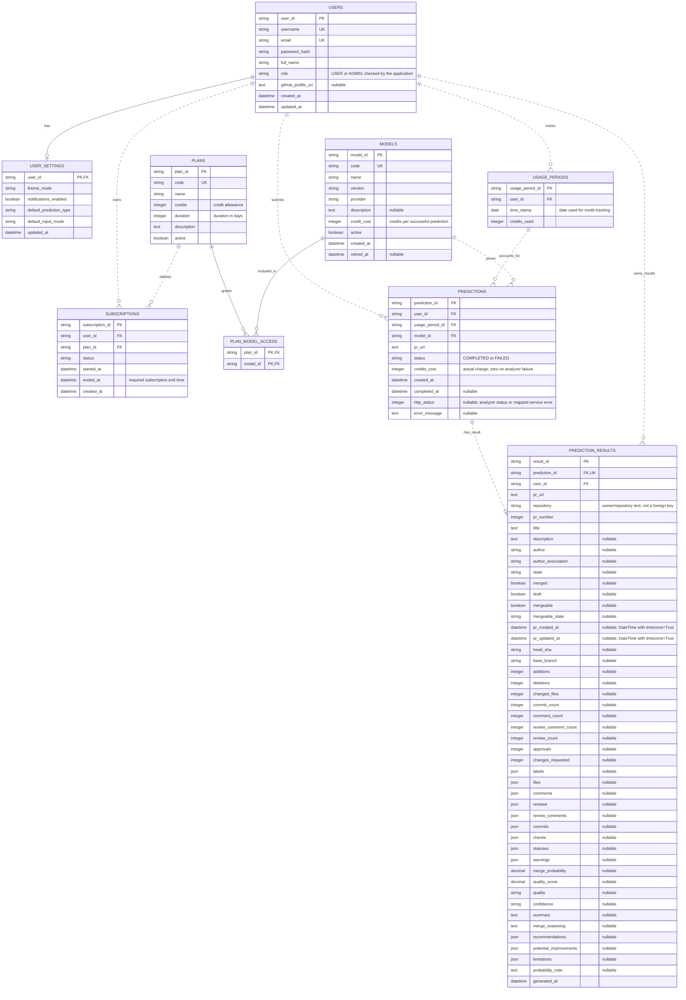

# Entity Relationship Diagram

Matches the 9 tables, 104 columns, and 11 foreign keys declared in [models.py](models.py), including the `plan_model_access` association table.

`PK` = primary key, `FK` = foreign key, `UK` = unique key. Fields marked `nullable` may be null; all other fields are required. Solid links include the parent key in the child primary key; dotted links use a separate child key. Exact SQL types and indexes are listed in [SCHEMA_DIAGRAM.md](SCHEMA_DIAGRAM.md).

## How the relationships are used

- **Users:** settings are optional one-to-one through `user_settings.user_id`. Users can have multiple subscriptions, usage records, predictions, and prediction results. Admin access comes from `users.role`.
- **Plans and models:** plans grant access directly through `plan_model_access`. Each plan has `credits` and a `duration` in days. There is no parent-plan relationship.
- **Subscriptions and usage:** `ended_at` is required. The application sets it from the start time and plan duration. Usage lookup uses the user and the subscription start date; `time_stamp` is a DATE. The database does not enforce uniqueness on that pair or link usage directly to a subscription.
- **Predictions:** each prediction belongs to a user, a usage record, and a model. The PR URL is stored directly on the prediction. Analyzer failures are saved with `status = FAILED`, `http_status`, `error_message`, and zero credits charged.
- **Results:** a prediction can have at most one result because `prediction_results.prediction_id` is unique. Successful analysis creates a result; failures do not. Results also have a direct foreign key to the user.
- **Analyzer data:** PR metadata is stored in result columns; feature lists and recommendations use JSON columns. Scores, quality, confidence, summary, reasoning, and the probability note are also stored on the result. There is no `analysis_response` column.

There are no current models for repositories, pull requests, prediction inputs, prediction features, or prediction factors. Repository and PR details belong to `prediction_results`. `/predict-dev` does not save predictions or charge credits.
