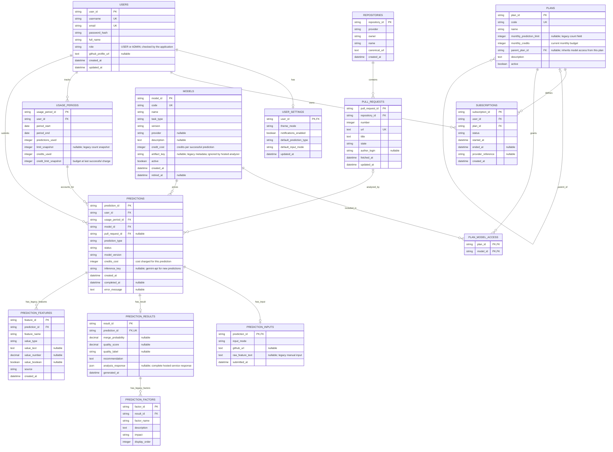

# Entity Relationship Diagram

Based on the current SQLAlchemy models in [models.py](models.py) and the prediction workflow in [app.py](app.py). All 14 tables and all their columns are shown, including fields retained for older data.

`PK` = primary key, `FK` = foreign key, `UK` = unique key. Fields marked `nullable` can be empty; the other fields are required by the model. Composite keys and SQL types are detailed in [SCHEMA_DIAGRAM.md](SCHEMA_DIAGRAM.md).

## How the relationships are used

- **Admin access:** an admin is a row in `users` with `role = ADMIN`. There is no separate admin table.
- **Plan access:** `plan_model_access` assigns models directly to a plan. `plans.parent_plan_id` adds the parent plan's models, recursively. Inheritance changes model access, not the monthly credit budget.
- **Credits:** each user has at most one `usage_periods` row per calendar month. A successful `/predict` request adds the chosen model's `credit_cost` to `credits_used` and records that cost in `predictions.credits_cost`. Switching plans keeps the month's existing usage.
- **Analysis and history:** the backend calls the hosted `/analyze` service. It saves repository/PR metadata, a prediction, its input URL, and a result. `prediction_results.analysis_response` holds the complete response, including features, analysis, and `probability_note`. `/predict-dev` does not save records or charge credits.
- **Older history:** `prediction_features` and `prediction_factors` remain for older predictions. New predictions store features and explanations in `analysis_response` instead. Models are catalog entries for access and cost; every entry uses the same hosted service.

The optional one-to-one links reflect the database constraints: the schema permits a user without settings and a prediction without an input/result. The normal application workflow creates those rows. `predictions.pull_request_id` is nullable for compatibility with old records; new predictions always use a GitHub PR.
