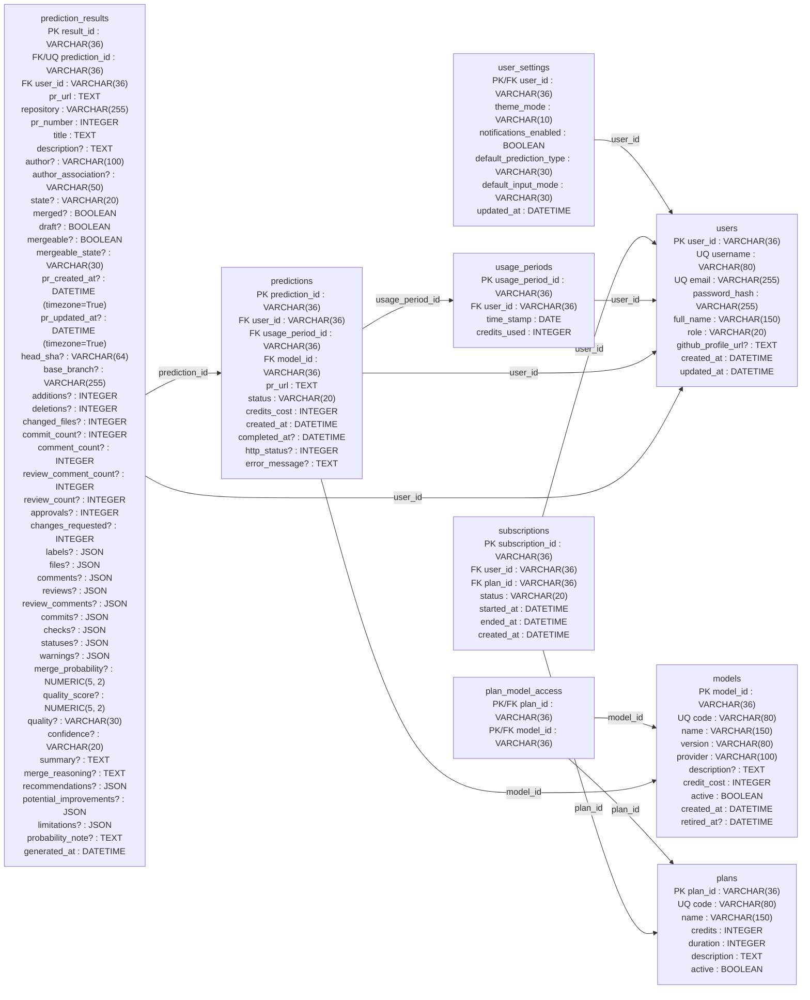

# Relational Schema Diagram

Matches the 9 tables, 104 columns, and 11 foreign keys declared in [models.py](models.py). [database.py](database.py) uses SQLite by default or the configured `DATABASE_URL`. This describes the current model schema; old SQLite databases may also retain archived tables after migration.

`PK` = primary key, `FK` = foreign key, `UQ` = unique column. A `?` means nullable. Each arrow points from a foreign-key column to its referenced primary key. Types, lengths, and numeric precision follow the SQLAlchemy declarations.

## Keys and constraints

| Table | Key or uniqueness rule |
| --- | --- |
| `users` | `user_id` is the primary key. `username` and `email` are individually unique. |
| `user_settings` | `user_id` is both the primary key and a foreign key to `users.user_id`, allowing at most one settings row per user. |
| `plans` | `plan_id` is the primary key; `code` is unique. There is no parent-plan foreign key. |
| `plan_model_access` | Composite primary key `(plan_id, model_id)`. Both columns are required foreign keys; duplicate grants are prevented. |
| `models` | `model_id` is the primary key; `code` is unique. |
| `subscriptions` | `subscription_id` is the primary key. `user_id` and `plan_id` are required foreign keys. `ended_at` is not nullable. The application manages active subscriptions; there is no database uniqueness rule limiting active subscriptions per user. |
| `usage_periods` | `usage_period_id` is the primary key; `user_id` is a required foreign key. `time_stamp` is a required DATE. There is no unique constraint on `(user_id, time_stamp)` and no subscription foreign key. |
| `predictions` | `prediction_id` is the primary key. Required foreign keys reference a user, usage record, and model. `pr_url` is required but not unique. |
| `prediction_results` | `result_id` is the primary key. `prediction_id` is a required, unique foreign key; `user_id` is a separate required foreign key. The database does not enforce that both references belong to the same user; the application supplies matching IDs. |

Role/status values and numeric ranges are checked by application logic and request validation, not database enum/check constraints. Model defaults are supplied by SQLAlchemy; they are not SQL server defaults.

## Explicit indexes

| Index | Columns | Unique |
| --- | --- | --- |
| `ix_users_email` | `users.email` | Yes |
| `ix_users_username` | `users.username` | Yes |
| `ix_predictions_pr_url` | `predictions.pr_url` | No |
| `ix_predictions_user_id` | `predictions.user_id` | No |
| `ix_prediction_results_repository` | `prediction_results.repository` | No |
| `ix_prediction_results_user_id` | `prediction_results.user_id` | No |

Primary keys and unique constraints are listed separately above.

## Current storage

| Field or group | Purpose |
| --- | --- |
| `plans.credits`, `plans.duration` | Credit allowance and duration in days. ORM defaults are 5 credits and 1 day. |
| `subscriptions.started_at`, `subscriptions.ended_at` | The subscription start and required end time. The application calculates the end from the selected plan duration. |
| `models.provider`, `models.credit_cost` | Provider metadata and cost per successful prediction. ORM defaults are `local` and 1 credit; seeded models use `gemini-api`. |
| `usage_periods.time_stamp`, `usage_periods.credits_used` | The date used for usage lookup and credits spent. The app looks up the subscription start date and carries spent credits when switching plans. |
| `predictions.pr_url`, `status`, `credits_cost`, `http_status`, `error_message` | The requested PR, outcome, actual charge, and failure information. Analyzer failures have no result and charge zero credits. |
| `prediction_results.user_id`, `pr_url`, `repository`, `pr_number`, `title` | Required ownership and PR metadata. Repository is text, not a foreign key. |
| Other PR metadata columns | Description, author, PR state, timestamps, branches, SHA, change counts, and review counts. |
| Feature JSON columns | `labels`, `files`, `comments`, `reviews`, `review_comments`, `commits`, `checks`, `statuses`, and `warnings`. |
| Analysis columns | `merge_probability`, `quality_score`, `quality`, `confidence`, `summary`, and `merge_reasoning`. The two score columns use `NUMERIC(5, 2)`. |
| Analysis JSON columns | `recommendations`, `potential_improvements`, and `limitations`. |
| `probability_note`, `generated_at` | The analyzer caveat and time the result was saved. |

`pr_created_at` and `pr_updated_at` are declared as `DateTime(timezone=True)`. The application converts their values to UTC before storage; SQLite stores them without an offset. Other datetime columns use the default `timezone=False`.

## Seed values

| Plan | Credits | Duration in days | Assigned models |
| --- | --- | --- | --- |
| FREE | 5 | 1 | model-1 |
| PLUS | 30 | 30 | models 1-3 |
| PRO | 100 | 30 | models 1-6 |
| ULTRA | 300 | 30 | models 1-6 |

These are defaults for new records, not database constraints. Admin changes survive seeding. All model assignments are direct.

There are no separate admin, history, or API-token tables. Admin rights use `users.role`, history reads predictions/results, and the analyzer token comes from `PR_ANALYZER_TOKEN`.

The current models do not declare the old repository, pull-request, input, feature, or factor tables, monthly-credit snapshots, model artifact keys, prediction types/versions, or a full-response JSON column. Startup creates missing current tables and runs the supported legacy SQLite migration; archived physical tables are outside this model diagram.
