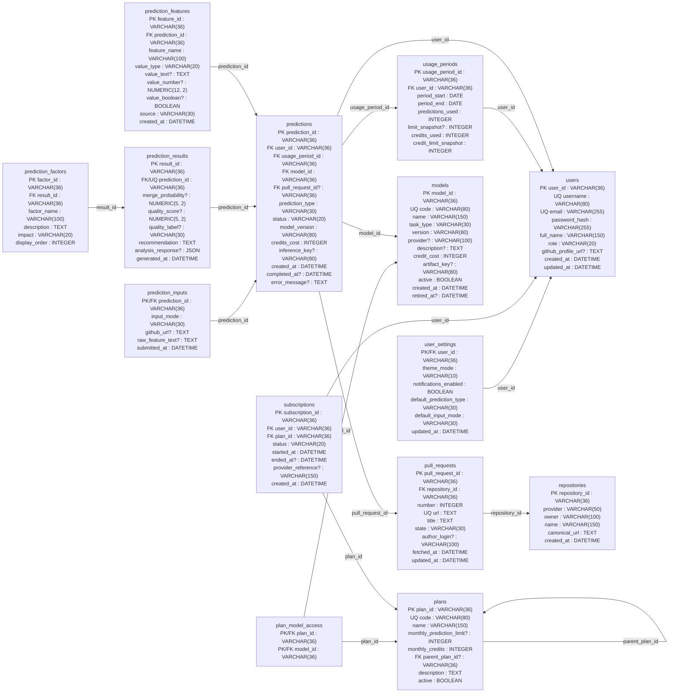

# Relational Schema Diagram

This is the schema declared in [models.py](models.py). [database.py](database.py) uses SQLite by default or the configured `DATABASE_URL`. Startup creates missing tables and adds supported missing columns through `migrate_schema()` in [app.py](app.py).

`PK` = primary key, `FK` = foreign key, `UQ` = unique column. A `?` after a field name means it is nullable. Each arrow points from a foreign-key column to the referenced table's primary key. SQL types, lengths, and numeric precision come from the current model definitions.

## Keys and constraints

| Table | Key or uniqueness rule |
| --- | --- |
| `users` | `user_id` is the primary key; `username` and `email` are individually unique. |
| `user_settings` | `user_id` is both the primary key and a foreign key to `users`. |
| `plans` | `plan_id` is the primary key; `code` is unique; the nullable parent references `plans.plan_id`. |
| `models` | `model_id` is the primary key; `code` is unique. |
| `plan_model_access` | Composite primary key `(plan_id, model_id)` prevents duplicate direct grants. Both fields are foreign keys. |
| `subscriptions` | `subscription_id` is the primary key. The application manages the active subscription; the database does not impose one active subscription per user. |
| `usage_periods` | `usage_period_id` is the primary key; `(user_id, period_start)` is unique. |
| `repositories` | `repository_id` is the primary key; `(provider, owner, name)` is unique. |
| `pull_requests` | `pull_request_id` is the primary key; `url` is unique; `(repository_id, number)` is also unique. |
| `predictions` | `prediction_id` is the primary key; references a user, usage period, model, and optionally a PR. |
| `prediction_inputs` | `prediction_id` is both the primary key and a foreign key, allowing at most one input per prediction. |
| `prediction_results` | `result_id` is the primary key; `prediction_id` is a unique foreign key, allowing at most one result per prediction. |
| `prediction_features` | `feature_id` is the primary key; multiple feature rows may reference one prediction. |
| `prediction_factors` | `factor_id` is the primary key; multiple factor rows may reference one result. |

Roles (`USER`/`ADMIN`), non-negative plan credits, positive model costs, and acyclic plan inheritance are validated by application code, not database enum/check constraints. Unique indexes are declared on `users.username` and `users.email`; a non-unique index is declared on `predictions.user_id`.

## Current storage and legacy fields

| Field or table | Current purpose |
| --- | --- |
| `plans.monthly_credits` | The active plan's monthly credit budget. |
| `models.credit_cost` | Cost of one successful prediction using this catalog entry. |
| `usage_periods.credits_used` | Credits already spent by the user in the month; used to enforce the budget. |
| `usage_periods.credit_limit_snapshot` | Budget when usage was created or last charged; current availability uses the active plan's budget. |
| `predictions.credits_cost`, `model_version`, `inference_key` | Values saved at prediction time; new inference keys are `gemini-api`. |
| `prediction_results.analysis_response` | Nullable JSON containing the full hosted service response; null for old predictions without a saved response. |
| `plans.monthly_prediction_limit`, `usage_periods.limit_snapshot` | Compatibility fields from the old prediction-count system; credit checks no longer use them. |
| `models.artifact_key` | Compatibility metadata; no local artifact is loaded. |
| `prediction_inputs.raw_feature_text` | Old manual-input data; new requests store `github_url` with `input_mode = GITHUB_URL`. |
| `prediction_features`, `prediction_factors` | Kept to read older history. New feature/analysis details are stored in the JSON response. |

Fresh databases seed Free with 5 credits and model 1, Plus with 30 credits and models 1–3, Pro with 100 credits and Plus access plus models 4–6, and Ultra with 300 credits and Pro access. Admins can change credits, model costs, and access. These are seed values, not database constraints; there is no current unlimited-plan rule.

There are no separate admin, history, or API-token tables. Admin rights come from `users.role`; history queries the prediction tables; the hosted-service token comes from the `PR_ANALYZER_TOKEN` environment variable. Existing databases are upgraded by additive migrations, so older physical constraints can differ from the current model declarations shown here.
